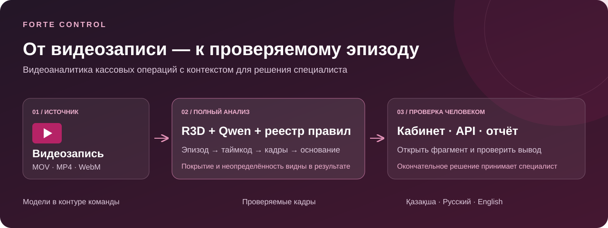
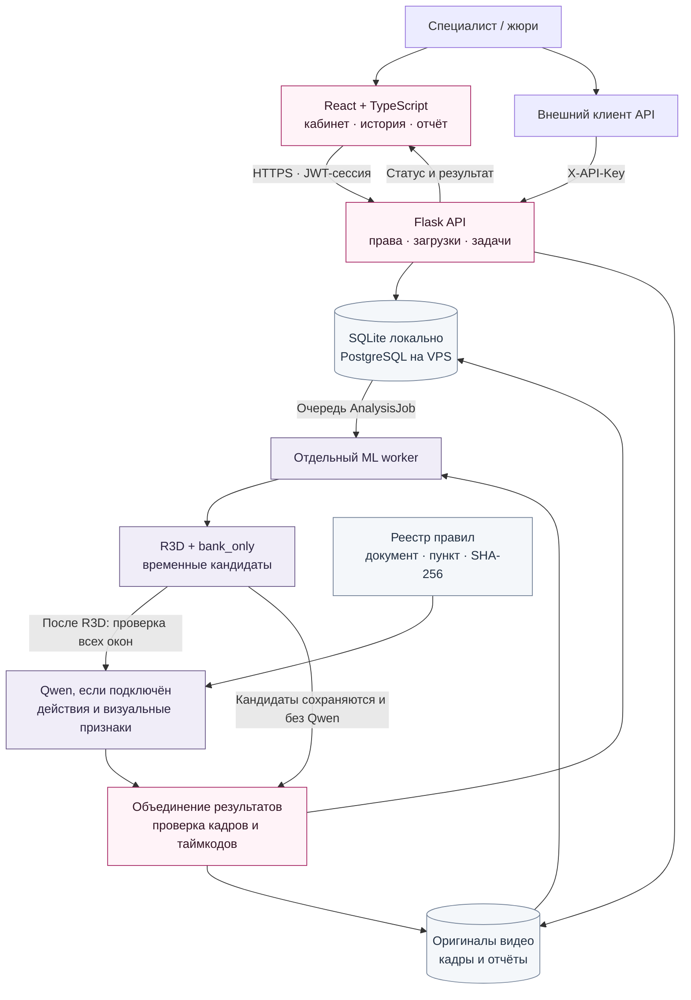
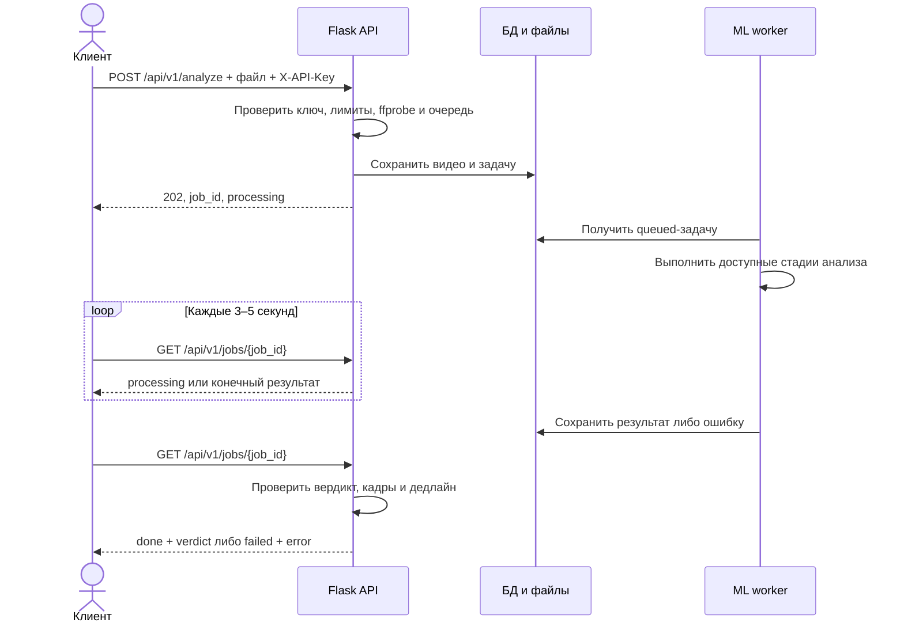
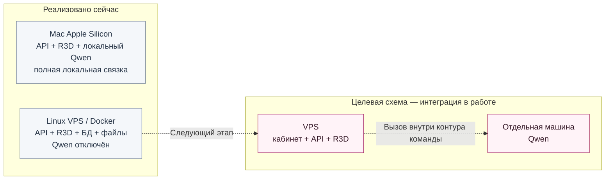

# Forte Control

**Видеоаналитика кассовых операций: найти эпизод, показать контекст, помочь специалисту проверить вывод.**



Forte Control — прототип системы поддержки внутреннего контроля, разработанный для кейса ForteBank. Пользователь загружает запись кассовой зоны, получает результат анализа и открывает интересующий фрагмент по таймкоду. Для возможного нарушения система собирает описание, связанные кадры и, если удалось сопоставить наблюдаемые признаки с правилом, нормативное основание.

**Результат предназначен для проверки человеком.** Сервис не устанавливает виновность, намерения или корректность операций в банковской системе, к которой у него нет доступа.

Этот README описывает код репозитория на **18 октября 2026 года**. Наличие функции в коде, успешный локальный запуск и состояние публичного сервера — разные уровни готовности. Ниже они разделены, чтобы проект можно было воспроизвести без догадок.

[Веб-стенд](https://foodtrack.beast-inside.kz/) · [Страница API](https://foodtrack.beast-inside.kz/api-access) · [Swagger стенда](https://foodtrack.beast-inside.kz/forte/api/docs/) · [Исходный кейс](docs/Кейс_ForteBank.md)

Адреса выше — точки входа для демонстрации. Перед показом нужно проверить полный анализ на развернутой версии: доступность страницы или `/api/ready` сама по себе не подтверждает готовность ML.

## Навигация

- [Задача проекта и преимущества](#product)
- [Возможности кабинета](#features)
- [Текущая готовность и режимы работы](#status)
- [Архитектура и движение данных](#architecture)
- [Как работают модели и проверка правил](#ml)
- [Как читать результат](#result)
- [Что установить и скачать](#prerequisites)
- [Запуск через Docker](#docker)
- [Локальная разработка без моделей](#development)
- [Полный локальный анализ на Mac](#mac)
- [Настройки окружения](#configuration)
- [Swagger: проверка API из браузера](#swagger)
- [API: ключ, загрузка, результат](#api)
- [Доступ, безопасность и данные](#security)
- [Деплой на VPS и обновления](#deployment)
- [Тесты и критерии готовности](#testing)
- [Данные, обучение и метрики](#evaluation)
- [Диагностика проблем](#troubleshooting)
- [Структура репозитория и документация](#repository)
- [Следующие этапы и условия использования](#roadmap)

<a id="product"></a>
## Что решает проект

При ручной проверке записи специалисту нужно найти значимый момент, восстановить последовательность действий и объяснить, почему эпизод заслуживает внимания. Отдельная отметка «подозрительно» не даёт достаточного контекста для решения.

Forte Control строит работу вокруг **проверяемого эпизода**:

1. Получить видеозапись и сохранить оригинал.
2. Выделить временные фрагменты, требующие внимания.
3. Показать наблюдаемые действия и ограничения видимости.
4. Привязать вывод к конкретным кадрам и таймкодам.
5. Сопоставить признаки с проверяемым реестром правил, когда данных достаточно.
6. Дать специалисту открыть исходное видео и подготовить отчёт.

Ожидаемая польза — меньше времени на поиск фрагментов и более последовательная проверка событий. Экономия времени и снижение числа пропусков ещё должны быть измерены на независимом пилоте; в проекте не заявляется неподтверждённый процент эффективности.

### Что делает решение сильным

| Преимущество | Что реализовано | Польза для проверяющего |
| --- | --- | --- |
| Вывод с видеоконтекстом | Таймкоды, связанные кадры, переход к оригиналу | Можно самостоятельно проверить, на чём основан результат |
| Разделение поиска события и его объяснения | R3D выделяет кандидатов; Qwen в полной связке анализирует видимые действия | Бинарный сигнал не выдаётся за автоматически установленный тип нарушения |
| Проверяемое нормативное основание | Версионированный реестр, снимок источника и проверка SHA-256 | Название документа и пункт берутся из реестра, а не придумываются моделью |
| Честное поведение при сбоях | Неполное покрытие, `unclassified`, явные ошибки | Отсутствие результата не маскируется под «нарушений нет» |
| Модели под контролем команды | Локальный запуск; веса скачиваются отдельно, инференс не дообучает модель | Основа для переноса во внутренний контур |
| Кабинет и машинный интерфейс | Асинхронный HTTP API, история, просмотр видео, отчёт | Анализ доступен человеку и внешней системе |
| Контроль доступа | Права на отделения и камеры, изоляция API-клиентов, MFA администраторов | Проверки доступа выполняет сервер |
| Три языка интерфейса | Қазақша, русский, English | Один рабочий процесс для разных пользователей |
| Воспроизводимая поставка | Docker, миграции БД, фиксированные веса и CI | Можно проверить состав сборки и повторить технические проверки |

<a id="features"></a>
## Возможности кабинета

| Раздел | Что можно сделать |
| --- | --- |
| Главная страница | Познакомиться с продуктом, перейти в кабинет или к API |
| Авторизация | Войти в личный аккаунт; пройти MFA, если она требуется; использовать разрешённый демовход |
| Загрузка видео | Передать MOV, MP4 или WebM; увидеть состояние загрузки и анализа |
| История | Найти сохранённые записи и вернуться к результатам |
| Карточка анализа | Смотреть исходное видео, эпизоды, таймкоды, кадры, объяснения и доступные основания |
| Отчёт | Добавить контекст и комментарий, скачать HTML с кадрами, распечатать или сохранить PDF средствами браузера |
| Камеры и мониторинг | Просматривать поступившие проверки состояния камер и интервалы проблем |
| Обзор смены | Работать с событиями и связанным видеоконтекстом |
| Уведомления | Просматривать оповещения и сохранять отметки прочтения |
| Страница API | Получить отдельный API-ключ и ознакомиться с интеграцией без регистрации |

Переключение языка сохраняется в браузере. Машинные описания и нормативные цитаты не становятся автоматически переведёнными только от смены языка интерфейса. Подробнее: [локализация](frontend/src/i18n/README.md).

**Мониторинг камер и анализ файлов — разные механизмы.** Состояния камер поступают через API от внешнего сборщика или специалиста. Автоматическое подключение к RTSP и постоянное чтение камер в текущем репозитории не реализованы.

### Демонстрационный доступ

При `DEMO_MODE=true` доступна кнопка входа в общий тестовый аккаунт:

```text
Логин:  demo@forte.test
Пароль: ForteDemo2026!
```

Это намеренно публичные реквизиты демоаккаунта, не секрет production. Аккаунт не является администратором и не получает доступ к рабочим камерам. Посетители общего аккаунта разделяют его загрузки: для него подходят только демонстрационные данные.

Docker создаёт аккаунт идемпотентно после миграций. При ручном запуске используйте `flask --app app init-db` или `flask --app app seed-demo-user`. Вход в общий аккаунт с реальным API и демонстрация интерфейса на готовых примерах — разные режимы; демонстрационные карточки не доказывают работу модели.

<a id="status"></a>
## Текущая готовность: какой режим что делает

Это ключевая таблица для запуска. **Qwen на малом VPS устанавливать не нужно: принято решение запускать его отдельно.** В текущем коде подключение отдельного Qwen ещё не реализовано; серверный режим явно обозначает отсутствие этой стадии.

| Режим | Где используется | Что выполняется | Какой результат ожидать |
| --- | --- | --- | --- |
| `ML_ENABLED=false`, `ML_AUTO_ANALYZE=false` | Разработка кабинета и backend | Авторизация, загрузки, история и API без запуска моделей | Видео сохранено; ML-вердикта нет |
| `reviewed_pipeline` + `ML_VLM_BACKEND=local` | Полный локальный запуск на Apple Silicon | R3D → локальная Qwen → проверка признаков по реестру → объединение результатов | Бинарный итог при достаточном результате; эпизоды могут остаться неклассифицированными |
| `reviewed_pipeline` + `ML_VLM_BACKEND=disabled` | Текущий Docker по умолчанию | R3D и банковская голова; Qwen не запускается | Положительный сигнал сохраняется как `unclassified`; без него нет основания выдавать `no_violation`, задача завершается ошибкой |
| `objects` | Дополнительный режим YOLO | Детекции объектов и наблюдения движений | Наблюдения без нормативного вердикта; публичный API отклоняет их как `verdict_unavailable` |
| Отдельный Qwen-сервис | Планируемая схема развёртывания | Qwen работает на выделенной машине в контуре команды | Требуется завершить интеграцию и проверить её через публичный API |

Текущий `backend/services/analysis.py` поддерживает для `ML_VLM_BACKEND` только `local` и `disabled`. Переменная со значением `remote` или произвольным URL сама по себе не добавляет сетевой вызов.

В актуальной Docker-сборке уже присутствуют код ML, банковская голова, реестр правил и загрузка базовых весов R3D при сборке. Старые инструкции, в которых Docker описан как исключительно YOLO-сборка, относятся к предыдущему состоянию. Фактическую версию VPS проверяют отдельно.

<a id="architecture"></a>
## Архитектура и движение данных

Frontend и backend — самостоятельные проекты с разными URL. В разработке frontend работает на **3000**, API — на **6767**. Браузер обращается к backend напрямую; для этого настраивается CORS. Внешний серверный шлюз может публиковать API под префиксом `/forte`.



Схема показывает компоненты полной связки и ветку сохранения R3D-кандидатов. В текущем Docker узел Qwen отключён; это не скрытый внешний сервис.

### Почему анализ выполняет отдельный worker

HTTP-процесс принимает файл и создаёт запись задачи. Длительный инференс выполняется отдельно, поэтому загрузка не держит один HTTP-запрос до окончания модели. Очередь хранится в БД; Redis и Celery для текущей реализации не требуются. Процессы API и worker используют одну БД и одно медиахранилище.



### Размещение компонентов



Отдельная машина с собственной моделью — часть инфраструктуры команды. Подключение стороннего облачного AI API не является предлагаемым способом запуска: кейс требует обработки внутри развёрнутого командой сервиса. После предварительной загрузки весов полная локальная связка рассчитана на обработку без доступа к интернету.

### Технологический стек

| Слой | Технологии | Где закреплены зависимости |
| --- | --- | --- |
| Интерфейс | React, TypeScript, Tailwind CSS, Zustand, React Router | [frontend/package.json](frontend/package.json), lock-файл npm |
| HTTP API | Flask, SQLAlchemy, Flask-Migrate/Alembic, Flask-JWT-Extended | [backend/requirements.txt](backend/requirements.txt) |
| Данные | SQLite локально, PostgreSQL 16 в production, файловое медиахранилище | Compose и конфигурация backend |
| Видео | FFmpeg/ffprobe, PyAV, OpenCV, Pillow | Dockerfile и ML requirements |
| Банковская модель | PyTorch, Torchvision, R3D18, обученная голова bank_only | [requirements-inference.txt](ML/requirements-inference.txt) и манифест весов |
| Локальная визуально-языковая модель | Qwen3-VL, MLX, mlx-vlm | [requirements-review-mac.txt](ML/requirements-review-mac.txt) |
| Поставка | Docker Compose, Gunicorn, nginx для frontend, GitHub Actions | Dockerfile, Compose и workflow |

<details>
<summary><strong>Словарь: что означают термины в этом руководстве</strong></summary>

| Термин | Простыми словами |
| --- | --- |
| Инференс | Применение уже обученной модели к новому видео; веса при этом не меняются |
| Worker | Отдельный процесс, который берёт задачи из очереди и выполняет анализ |
| Энкодер / backbone | Базовая модель, преобразующая изображения или фрагменты видео в числовые признаки |
| Банковская голова | Обученная на банковской разметке часть модели, использующая признаки энкодера |
| Кандидат / эпизод | Выделенный временной фрагмент; сам факт выделения ещё не устанавливает тип нарушения |
| VLM | Модель, работающая одновременно с изображениями и текстовыми инструкциями; здесь — Qwen |
| PTS | Временная отметка кадра из декодера видео; используется для привязки к оригиналу |
| Development-выборка | Данные, участвующие в разработке и выборе решения; их метрики нельзя выдавать за независимый финальный тест |
| SHA-256 | Контрольная сумма файла для проверки его идентичности и целостности |

</details>

<a id="ml"></a>
## Как работает анализ

### 1. Приём и проверка видео

- Принимается один файл MOV, MP4 или WebM размером до **1 ГиБ**.
- `ffprobe` проверяет, что внутри поддерживаемого контейнера есть видеопоток.
- Проверяются место на диске, доступ пользователя, частота загрузок и ёмкость очереди.
- Оригинал сохраняется отдельно от кадров и результатов модели.

Анализ использует визуальные данные. Распознавание лиц, установление личности и анализ аудио не входят в этот процесс.

### 2. Поиск временных кандидатов: R3D

Банковский компонент — замороженный энкодер **R3D18** с обученной головой `bank_only`. Он использует два представления сцены: рабочую область и полный кадр. Его задача — выделить временные кандидаты, похожие на положительные примеры банковской разметки.

Базовые веса и банковская голова — **два разных файла**. Для запуска нужны оба. Голова не заменяет энкодер.

Рабочий порог — **0,5**. Оценка модели не является откалиброванной вероятностью нарушения. Детектор не устанавливает норму права и не определяет виновность.

Модель привязана к исходной камере **464 × 848**. При других размерах R3D сообщает `unsupported_camera`; в полной связке анализ полного кадра может продолжить Qwen. Это не означает, что качество на другой камере уже подтверждено.

### 3. Описание действий: Qwen

В полном локальном режиме используется **Qwen3-VL-4B-Instruct**, MLX-вариант с 4-битными весами. Модель получает последовательность кадров и их временные отметки. По умолчанию видео разбивается на окна до 12 секунд, из каждого выбираются 8 кадров; последние окна могут быть короче.

Qwen описывает наблюдаемые действия и проверяет визуальные признаки правил. Проверка охватывает временные окна, а не только положительные кандидаты R3D. Между выбранными кадрами остаются промежутки: быстрое действие может быть пропущено.

Рабочий вариант использует базовую Qwen без старого исследовательского LoRA-адаптера. Эксперименты с дообучением описаны отдельно в [CAPTION_MODEL.md](ML/CAPTION_MODEL.md); их наличие не означает, что адаптер применяется в production.

### 4. Сопоставление с реестром правил

Runtime-реестр находится в [`ML/regulations/rules_v1.json`](ML/regulations/rules_v1.json). Вместе с ним хранятся снимок нормативного источника, извлечённый текст и контрольная сумма. Модель должна связать вывод с видимыми условиями и выбранными кадрами; реквизиты основания сервер берёт из реестра.

В реестре представлены визуальные сценарии, связанные с личными вещами, пересчётом денег, деньгами предыдущей операции, перемещением денег, открытым устройством хранения и уходом во время обслуживания. Это перечень реализованных интерпретаций для анализа, а не исчерпывающее описание банковских требований.

Используемый снимок содержит редакцию от **16.03.2026**. Актуальность последующих изменений и применимость к конкретной операции требуют отдельной проверки. Подробности происхождения, ограничений и отключённых правил: [реестр и источники](ML/regulations/README.md).

### 5. Сборка результата и кадров

Система объединяет кандидатов R3D и выводы Qwen, сохраняет исходные временные отметки декодера и проверяет привязку кадров. Для эпизода API требует 1–3 разных JPEG, допустимые таймкоды и совпадение ключевого таймкода с одним из выбранных кадров.

Проверка формата и временной согласованности делает результат воспроизводимым, но не доказывает смысловую правильность вывода модели. Специалисту доступны кадры и исходное видео для самостоятельной проверки.

### Дополнительный режим YOLO

В репозитории также сохранён `cash_detector.pt`: YOLO11n для объектов `person`, `hand`, `cash`, `bag`, `storage_cabinet`. Он полезен для визуальных наблюдений и отладки, но не заменяет анализ действий и правил. Его показатели и ограничения находятся в [ML/RESULTS.md](ML/RESULTS.md).

<a id="result"></a>
## Как читать результат

**Статус задачи и вердикт — разные поля.** `done` означает, что задача завершилась и результат прошёл проверку формата; это не знак подтверждённого человеком нарушения.

| Поле / значение | Значение для пользователя |
| --- | --- |
| `status=processing` | Задача ожидает обработки или выполняется; публичный API объединяет эти состояния |
| `status=done` | Есть допустимый итоговый ответ |
| `status=failed` | Итог не удалось получить или выдать по контракту; нужно посмотреть `error.code` |
| `verdict=violation` | Обнаружены признаки возможного нарушения; требуется проверка специалиста |
| `verdict=no_violation` | В успешно проверенных окнах признаки не найдены; это не гарантия отсутствия любых нарушений |
| `classification_status=grounded` | Эпизод сопоставлен с правилом из реестра; вывод по-прежнему машинный |
| `classification_status=unclassified` | Положительный сигнал R3D сохранён, конкретный тип и основание не установлены |
| `rule=null` | Нормативное основание для этого эпизода отсутствует; оно не подставляется искусственно |
| `rule_evaluation=not_performed` | Проверка правил не выполнена |
| `coverage_status=partial` | В публичном ответе отмечено неполное покрытие анализа |

Внутренний отчёт хранит также `assessment_coverage`; публичный сериализатор отображает это значение как `coverage_status`.

Если Qwen отключён или завершился с ошибкой, положительные R3D-кандидаты могут остаться в результате как `unclassified`, с кадрами для проверки. **Если нет ни положительного сигнала, ни завершённой проверки правил, система не выдаёт «чистый» результат.** Неполное отрицательное заключение отклоняется API.

Эта семантика важна для демонстрации: наличие кадра рядом с сигналом R3D не означает, что кадр автоматически доказывает конкретный тип нарушения.

<a id="prerequisites"></a>
## Что установить и скачать

### Выберите цель запуска

| Цель | Что нужно | Инструкция |
| --- | --- | --- |
| Поднять приложение в контейнерах | Git, Docker Engine/Desktop и Compose; интернет на этапе сборки | [Docker](#docker) |
| Разрабатывать интерфейс и API без ML | Python 3.11, Node.js 24, FFmpeg/ffprobe | [Разработка](#development) |
| Воспроизвести полный анализ с Qwen | Mac Apple Silicon, Python 3.13, два Python-окружения, FFmpeg, веса R3D и Qwen | [Mac](#mac) |
| Развернуть сервер | Linux, Docker Compose, PostgreSQL через Compose, настроенный HTTPS-шлюз | [VPS](#deployment) |

Версии Python и Node здесь соответствуют конфигурации CI и описанному ML-окружению, а не требованию установить самый новый выпуск.

Официальные загрузки: [Python](https://www.python.org/downloads/), [Node.js](https://nodejs.org/en/download), [Docker](https://docs.docker.com/get-started/get-docker/), [FFmpeg](https://ffmpeg.org/download.html). FFmpeg содержит `ffprobe`; в Windows добавьте каталог `bin` в `PATH` либо задайте `FFPROBE_PATH`.

Команды ниже выполняются в локальной копии репозитория. Для её получения используйте URL этого репозитория из кнопки **Code** на GitHub:

```bash
git clone "<URL_ЭТОГО_РЕПОЗИТОРИЯ>" Forte
cd Forte
```

### Какие модели где находятся

| Артефакт | В Git | Как получить | Назначение |
| --- | --- | --- | --- |
| `ML/deployment/reviewed/bank_only.npz` | Да | Уже в checkout | Обученная банковская голова |
| `ML/deployment/reviewed/model_bundle.json` | Да | Уже в checkout | SHA-256, параметры и development-метрики |
| `ML/models/r3d_18-b3b3357e.pth` | Нет | `python ML/download_models.py --r3d`; Docker скачивает при сборке | Энкодер R3D |
| `ML/models/qwen3_vl_4b_mlx/` | Нет | `python ML/download_review_model.py --size 4b` в MLX-окружении на Mac | Локальный Qwen |
| `ML/deployment/cash_detector.pt` | Да | Уже в checkout | Дополнительный YOLO-режим |
| `ML/regulations/` | Да | Уже в checkout | Реестр правил и снимок источника |
| Исходные банковские видео и ручная разметка | Не поставляются как публичный набор | Предоставляются отдельно по условиям кейса | Оценка качества и обучение |

Для обычного инференса повторно обучать модели или скачивать все исследовательские датасеты не требуется. Загрузчики проверяют закреплённые контрольные суммы; рабочий инференс не должен скачивать веса на лету.

Размеры окружений и потребление памяти зависят от платформы, модели и видео. В истории проекта описан запуск на Apple M4 с 16 ГБ; это опыт конкретного окружения, не гарантия минимальных требований или времени обработки на любой машине.

<a id="docker"></a>
## Запуск через Docker

**Получите:** frontend, API, SQLite и ML worker с R3D. **Qwen в этом режиме отключён.** Для полного анализа с проверкой правил используйте [Mac](#mac) либо завершённую интеграцию отдельного Qwen-сервиса.

### 1. Подготовьте настройки

В корне проекта, Bash/macOS/Linux:

```bash
cp .env.example .env
```

В PowerShell:

```powershell
Copy-Item .env.example .env
```

Если `.env` уже существует, редактируйте его, не заменяйте шаблоном. Задайте **два разных случайных секрета**. Например, дважды выполните:

```bash
python -c "import secrets; print(secrets.token_hex(32))"
```

В `.env` проверьте:

```dotenv
SECRET_KEY=<первый-случайный-секрет>
JWT_SECRET_KEY=<второй-случайный-секрет>
BACKEND_PORT=6767
FRONTEND_PORT=3000
REACT_APP_API_URL=http://localhost:6767
CORS_ORIGINS=http://localhost:3000
COOKIE_SECURE=false
AUTH_COOKIE_PATH=/api/auth
DEMO_MODE=true
ML_ENGINE=reviewed_pipeline
ML_VLM_BACKEND=disabled
```

Значения в угловых скобках нужно заменить; они не являются рабочими секретами.

### 2. Соберите и запустите

```bash
docker compose up -d --build --wait
docker compose ps
docker compose logs --tail 100 backend ml-worker
```

При первой сборке скачиваются зависимости и закреплённые веса R3D. `check_reviewed_runtime.py` проверяет импорты, банковскую голову, энкодер и реестр. Веса и библиотеки Qwen/MLX в Linux-образ не включаются.

При старте backend применяет миграции, создаёт демоаккаунт при разрешённом режиме и добавляет справочный источник. Worker запускается отдельным контейнером после готовности API.

### 3. Откройте приложение

| Назначение | Адрес |
| --- | --- |
| Frontend | <http://localhost:3000> |
| Рабочий кабинет | <http://localhost:3000/workspace> |
| Страница API | <http://localhost:3000/api-access> |
| Swagger | <http://localhost:6767/api/docs/> |
| OpenAPI JSON | <http://localhost:6767/api/openapi.json> |
| Проверка API и БД | <http://localhost:6767/api/ready> |

Ответ `{"ready":true}` проверяет доступность БД, а не полный инференс. Для проверки анализа нужен реальный POST и конечный результат задачи.

### 4. Создайте личного администратора, если он нужен

```bash
docker compose exec backend flask --app app create-user --admin
docker compose exec backend flask --app app enroll-mfa
```

Команды интерактивно запрашивают реквизиты. Добавьте TOTP-секрет в приложение-аутентификатор в доверенной консоли. Production-конфигурация требует MFA для администратора.

Остановка с сохранением томов:

```bash
docker compose stop
```

`docker compose down` также сохраняет именованные тома, если не указан `-v`. **Не используйте `down -v` для обычного обновления: он удаляет тома с данными.**

<a id="development"></a>
## Локальная разработка без моделей

Этот путь подходит для работы над backend и frontend на Windows, Linux или macOS. Он намеренно не запускает инференс; загрузка видео должна сохранять запись без попытки вызвать отсутствующие веса.

### Backend — Windows / PowerShell

Из корня проекта:

```powershell
py -3.11 -m venv backend/.venv
backend/.venv/Scripts/python.exe -m pip install -r backend/requirements.txt
Copy-Item backend/.env.example backend/.env
```

В `backend/.env` задайте собственные `SECRET_KEY`, `JWT_SECRET_KEY` и добавьте:

```dotenv
ML_ENABLED=false
ML_AUTO_ANALYZE=false
```

Проверьте `ffprobe -version`, затем:

```powershell
Set-Location backend
.venv/Scripts/python.exe -m flask --app app init-db
.venv/Scripts/python.exe -m flask --app app seed-sources
.venv/Scripts/python.exe app.py
```

### Backend — macOS / Linux / Bash

```bash
python3.11 -m venv backend/.venv
backend/.venv/bin/python -m pip install -r backend/requirements.txt
cp backend/.env.example backend/.env
```

Отредактируйте `backend/.env` так же, как выше, затем:

```bash
cd backend
.venv/bin/python -m flask --app app init-db
.venv/bin/python -m flask --app app seed-sources
.venv/bin/python app.py
```

Для личной учётной записи используйте `python -m flask --app app create-user`, а для администратора добавьте `--admin`. Здесь и далее `python` должен указывать на выбранное виртуальное окружение. При существующей БД сначала следуйте процедуре обновления из [RUNBOOK](docs/RUNBOOK.md).

### Frontend — второй терминал

Из корня проекта:

```bash
cd frontend
npm ci
npm start
```

По умолчанию клиент обращается к `http://localhost:6767`. Если адрес другой, создайте `frontend/.env.local`:

```dotenv
REACT_APP_API_URL=http://localhost:6767
REACT_APP_DEMO_MODE=true
```

При изменении переменных перезапустите dev-server. Для production нужна пересборка: адрес API встраивается в frontend при сборке. Добавлять `/api` в `REACT_APP_API_URL` не нужно — клиент сам добавляет маршруты.

<a id="mac"></a>
## Полная локальная связка на Mac Apple Silicon

Этот сценарий воспроизводит R3D и Qwen на одной машине. Он не меняет принятое решение держать Qwen отдельно от малого VPS.

### 1. Подготовьте зависимости

Установите Python 3.13, Node.js и FFmpeg. Проверьте:

```bash
python3.13 --version
node --version
ffprobe -version
```

Из корня репозитория создайте **два отдельных окружения**:

```bash
python3.13 -m venv ML/.venv
ML/.venv/bin/python -m pip install --upgrade pip
ML/.venv/bin/python -m pip install -r backend/requirements.txt -r ML/requirements-mac.txt

python3.13 -m venv ML/.venv-review
ML/.venv-review/bin/python -m pip install --upgrade pip
ML/.venv-review/bin/python -m pip install -r ML/requirements-review-mac.txt
```

`ML/.venv` обслуживает API, worker и R3D. `ML/.venv-review` содержит MLX/Qwen и запускается из worker как отдельный процесс. Не переносите готовые `.venv` между Mac и Linux: окружения создаются на целевой платформе.

### 2. Скачайте веса

```bash
ML/.venv/bin/python ML/download_models.py --r3d
ML/.venv-review/bin/python ML/download_review_model.py --size 4b
```

Банковская голова и нормативный реестр уже находятся в Git. Исходные обучающие видео не нужны для анализа нового файла.

### 3. Настройте backend

Если `backend/.env` ещё нет, скопируйте `backend/.env.example`. Установите собственные секреты и проверьте:

```dotenv
FLASK_ENV=development
ML_ENABLED=true
ML_AUTO_ANALYZE=true
ML_ENGINE=reviewed_pipeline
ML_VLM_BACKEND=local
ML_VLM_MODEL_SIZE=4b
ML_VLM_INPUT_MODE=images
PORT=6767
CORS_ORIGINS=http://localhost:3000
```

Если ранее запускали режим без моделей, обязательно верните `ML_ENABLED=true`. Удалите устаревшие абсолютные пути к Python и весам другой машины либо замените их актуальными. Переменные уже открытого терминала имеют приоритет над `.env`.

### 4. Проверьте файлы и запустите API с worker

```bash
ML/.venv/bin/python scripts/run_local_pipeline.py --check
ML/.venv/bin/python scripts/run_local_pipeline.py
```

Скрипт проверяет наличие runtime-файлов, применяет миграции и запускает API с worker. При отсутствии заданного ключа жюри создаётся локальный файл `backend/instance/jury-api-key.txt`, исключённый из Git. Ключ не нужно переносить во frontend.

`--check` — проверка наличия файлов и настроек, не полноценный прогон видео. Уже работающий API на порту 6767 нужно остановить до запуска скрипта.

Во втором терминале:

```bash
cd frontend
npm ci
npm start
```

Откройте кабинет, загрузите разрешённое тестовое видео и дождитесь конечного результата. API слушает `127.0.0.1:6767`; скрипт не публикует его в интернете.

Логи:

```text
ML/runs/local_service/api.log
ML/runs/local_service/worker.log
```

Остановка `Ctrl+C` завершает оба процесса, запущенных скриптом. История исследований и ограничения окружения: [MAC_TRAINING.md](ML/MAC_TRAINING.md).

<a id="configuration"></a>
## Настройки окружения

В проекте три разных места настройки. **Корневой `.env` не заменяет `backend/.env` при запуске через `python app.py`.**

| Файл | Кто читает | Когда применяется |
| --- | --- | --- |
| `.env` в корне | Docker Compose | Создание/пересоздание контейнеров; часть значений передаётся в сборку frontend |
| `backend/.env` | Flask-приложение при локальном запуске | Старт процесса Python |
| `frontend/.env.local` | React Scripts | Старт dev-server или production-сборка |

### Основные параметры

| Переменная | Назначение |
| --- | --- |
| `SECRET_KEY`, `JWT_SECRET_KEY` | Два разных случайных секрета backend; не публиковать |
| `DATABASE_URL` | SQLite при локальном запуске или PostgreSQL; в Compose задаётся конфигурацией сервиса |
| `POSTGRES_PASSWORD` | Обязателен для `compose.production.yaml` |
| `REACT_APP_API_URL` | Базовый адрес backend без завершающего `/api`; может включать `/forte` |
| `CORS_ORIGINS` | Разрешённые адреса frontend через запятую |
| `BACKEND_PORT`, `FRONTEND_PORT` | Порты публикации Docker; по умолчанию 6767 и 3000 |
| `PORT` | Порт прямого запуска `python app.py` |
| `COOKIE_SECURE` | `true` для HTTPS, `false` для локального HTTP |
| `AUTH_COOKIE_PATH` | `/api/auth` локально; `/forte/api/auth` при публикации API под `/forte` |
| `DEMO_MODE` | Разрешить общий демоаккаунт; Compose передаёт флаг и во frontend |
| `REACT_APP_DEMO_MODE` | Флаг кнопок демовхода при отдельной сборке frontend |
| `MEDIA_ROOT` | Каталог оригиналов, кадров и результатов; должен быть общим для API и worker |
| `FFPROBE_PATH` | Путь к `ffprobe`, если он отсутствует в `PATH` |
| `ML_ENABLED`, `ML_AUTO_ANALYZE` | Доступность ML и автоматический запуск после загрузки |
| `ML_ENGINE` | Основной `reviewed_pipeline`; дополнительные `reviewed_temporal`, `dense_vlm`, `objects` |
| `ML_VLM_BACKEND` | `local` для локального MLX или `disabled` для отложенного Qwen; сетевой провайдер пока не реализован |
| `ML_REVIEWED_PYTHON` | Python с зависимостями R3D |
| `ML_REVIEWED_BUNDLE`, `ML_REVIEWED_BACKBONE` | Пути к манифесту банковской головы и базовым весам |
| `ML_VLM_PYTHON` | Python окружения локальной Qwen |
| `ML_VLM_MODEL_SIZE`, `ML_VLM_INPUT_MODE` | По умолчанию `4b` и `images` |
| `ML_DEVICE` | Устройство R3D; Linux Compose задаёт `cpu`, локально возможен автоматический выбор |
| `JURY_API_KEY`, `JURY_API_KEY_FILE` | Отдельный секрет жюри или файл с ним |

Не каждый параметр из `backend/config.py` читается из окружения. Например, `ML_QUEUE_LIMIT`, `ML_JOB_TIMEOUT` и `API_JOB_DEADLINE` сейчас заданы в Python-конфигурации: простое добавление одноимённой строки в `.env` их не переопределяет.

В `compose.production.yaml` движок явно закреплён как `reviewed_pipeline`. При диагностике учитывайте приоритеты Compose, а не только содержимое `.env`.

<a id="swagger"></a>
## Swagger / OpenAPI: проверка API из браузера

Swagger — интерактивная документация backend. В ней можно посмотреть маршруты, обязательные поля, схемы ответов и коды ошибок, а затем выполнить запрос прямо из браузера через **Try it out → Execute**. Отдельная установка Swagger не требуется: он входит в зависимости backend.

| Окружение | Swagger UI | Спецификация OpenAPI 3.0.3 |
| --- | --- | --- |
| Локальный запуск | [localhost:6767/api/docs/](http://localhost:6767/api/docs/) | [localhost:6767/api/openapi.json](http://localhost:6767/api/openapi.json) |
| Публичный стенд | [foodtrack.beast-inside.kz/forte/api/docs/](https://foodtrack.beast-inside.kz/forte/api/docs/) | [foodtrack.beast-inside.kz/forte/api/openapi.json](https://foodtrack.beast-inside.kz/forte/api/openapi.json) |

Открывайте адрес Swagger с завершающим `/`. Если backend опубликован под префиксом `/forte`, сохраняйте его в адресе. Интерфейс, JavaScript и CSS раздаются самим backend без CDN; для локального просмотра документации интернет не требуется.

### Проверить анализ видео по API-ключу

1. Откройте Swagger и найдите группу **Публичный API**.
2. Раскройте `POST /api/v1/api-keys`, нажмите **Try it out**, затем **Execute**. Тело запроса и регистрация не нужны.
3. В ответе HTTP `201` скопируйте значение `api_key`. Оно возвращается только при создании ключа.
4. Нажмите **Authorize** в верхней части страницы. В поле **ApiKeyAuth** вставьте только сам ключ, без `X-API-Key:` и без `Bearer`. Нажмите **Authorize**, затем **Close**. Если у вас уже есть ключ жюри, вставьте его сюда вместо создания нового.
5. Раскройте `POST /api/v1/analyze`, нажмите **Try it out**, выберите видео в поле **file** и нажмите **Execute**.
6. Из ответа HTTP `202` скопируйте `job_id`.
7. В группе **Анализ** откройте `GET /api/v1/jobs/{job_id}`, нажмите **Try it out**, вставьте идентификатор задачи и нажмите **Execute**.
8. Повторяйте только GET с интервалом 3–5 секунд, пока `status` не станет `done` или `failed`. Swagger не запускает автоматический опрос задачи.

Используйте тот же ключ для загрузки и чтения результата. Если ранее включили **BearerAuth**, отключите его через **Logout** в окне **Authorize** перед проверкой API по ключу: одновременная отправка JWT и `X-API-Key` на маршрутах анализа запрещена.

При `failed` смотрите `error.code` и [таблицу диагностики](#troubleshooting). Swagger отправляет запросы в тот же backend и не обходит ограничения текущего ML-режима. В частности, он не подключает отсутствующий Qwen и не превращает незавершённый анализ в успешный.

### Проверить API личного кабинета через JWT

1. В группе **Авторизация** откройте `POST /api/auth/login` и нажмите **Try it out**.
2. Передайте свой `identifier` и `password`; при настроенной MFA добавьте текущий код в поле `otp`. Пример формы запроса:

   ```json
   {
     "identifier": "your-account@example.com",
     "password": "<пароль-вашего-аккаунта>"
   }
   ```

3. Из успешного ответа скопируйте `access_token` в **Authorize → BearerAuth**, **без префикса `Bearer`**: Swagger добавляет его самостоятельно.
4. Отключите **ApiKeyAuth**, если он был включён. Выполните `GET /api/auth/me`, чтобы проверить текущего пользователя, затем переходите к доступным ему маршрутам кабинета.
5. Для `refresh` и `logout` вставьте полученный `csrf_token` в **Authorize → CsrfToken**. Refresh-cookie браузер сохраняет после входа автоматически; вручную копировать её не нужно.
6. После успешного `refresh` обновите значения **BearerAuth** и **CsrfToken** из нового ответа. Административные методы требуют соответствующей роли и MFA в production.

Для маршрутов подписанных файлов используется **SignedToken** — значение параметра `token` из ссылки, выданной API для конкретного объекта. Это отдельная подпись, а не JWT и не API-ключ.

### Важные особенности

- **Try it out выполняет реальные запросы:** загрузка создаёт запись, изменяющие методы меняют данные. Используйте тестовую учётную запись и разрешённые видео.
- Авторизация Swagger не сохраняется в `localStorage`; после перезагрузки страницы ключ или токен нужно ввести снова. Не создавайте новый API-ключ только ради обновления страницы: новый ключ не открывает задачи предыдущего клиента.
- За HTTPS-шлюзом при ошибке проверки Origin на входе сверяйте публичный origin backend с `CORS_ORIGINS`; при префиксе `/forte` проверьте также `AUTH_COOKIE_PATH=/forte/api/auth`.
- OpenAPI JSON можно импортировать в Postman или другой совместимый клиент. Контракт формируется в [`backend/api_docs.py`](backend/api_docs.py), интерфейс — в [`backend/templates/swagger.html`](backend/templates/swagger.html).

<a id="api"></a>
## API: от ключа до результата

API доступен без учётной записи пользователя. Существуют два типа ключей:

- **Выданный API-ключ:** создаётся через `POST /api/v1/api-keys`, действует 30 дней, предоставляет доступ только к задачам этого клиента.
- **Ключ жюри:** задаётся оператором через `JURY_API_KEY` или `JURY_API_KEY_FILE`; предназначен для отдельного сценария проверки.

Для отправки и чтения задачи нужен один и тот же ключ. Не смешивайте `Authorization` и `X-API-Key` в одном запросе. JWT кабинета обслуживает отдельный пользовательский сценарий.

### Основные маршруты

| Метод | Маршрут | Назначение |
| --- | --- | --- |
| `GET` | `/api` | Проверка жизни HTTP-процесса |
| `GET` | `/api/ready` | Проверка доступа к доменной таблице БД |
| `GET` | `/api/docs/` | Swagger UI |
| `GET` | `/api/openapi.json` | Машиночитаемая спецификация |
| `POST` | `/api/v1/api-keys` | Выдать новый публичный ключ |
| `DELETE` | `/api/v1/api-keys/current` | Отозвать текущий выданный ключ |
| `POST` | `/api/v1/analyze` | Загрузить файл и создать задачу |
| `GET` | `/api/v1/jobs/{job_id}` | Получить состояние или результат задачи |
| `POST` | `/api/v1/media` | Загрузка через пользовательскую JWT-сессию |
| `GET` | `/api/v1/media/{id}/analysis` | Анализ пользовательской записи |
| `GET` | `/api/v1/media/{id}/report` | Данные отчёта пользовательской записи |
| `POST` | `/api/v1/cameras/{id}/health` | Принять внешнюю проверку состояния камеры |

### Пример: Bash + curl + Python 3

Для локального API:

```bash
API_BASE=http://localhost:6767
```

Для опубликованного стенда:

```bash
API_BASE=https://foodtrack.beast-inside.kz/forte
```

Получите ключ без вывода секрета в консоль:

```bash
API_KEY=$(curl --fail-with-body -sS -X POST "$API_BASE/api/v1/api-keys" \
  | python3 -c 'import json,sys; print(json.load(sys.stdin)["api_key"])')
```

Загрузите собственное разрешённое тестовое видео. Замените `./video.mov` на путь к файлу:

```bash
JOB_ID=$(curl --fail-with-body -sS -X POST "$API_BASE/api/v1/analyze" \
  -H "X-API-Key: $API_KEY" \
  -F 'file=@./video.mov' \
  | python3 -c 'import json,sys; print(json.load(sys.stdin)["job_id"])')
```

Ожидаемый ответ POST: HTTP `202`, `job_id`, `status=processing`. Запрашивайте результат раз в 3–5 секунд до `done` или `failed`:

```bash
curl --fail-with-body -sS "$API_BASE/api/v1/jobs/$JOB_ID" \
  -H "X-API-Key: $API_KEY"
```

`202` подтверждает постановку задачи, а не успешность инференса. При сетевом сбое не повторяйте загрузку автоматически: первая отправка могла сохраниться. Для выданного публичного ключа повторный POST не является идемпотентным.

После сохранения нужных результатов временный выданный ключ можно отозвать:

```bash
curl --fail-with-body -sS -X DELETE "$API_BASE/api/v1/api-keys/current" \
  -H "X-API-Key: $API_KEY"
unset API_KEY
```

Отзыв закрывает доступ по ключу, но не удаляет файлы и не отменяет уже выполняющийся анализ. Этот маршрут не предназначен для отзыва настроенного серверного секрета жюри.

### Пример для PowerShell

```powershell
$apiBase = 'http://localhost:6767'
$issued = Invoke-RestMethod -Method Post -Uri "$apiBase/api/v1/api-keys"
$apiHeaders = @{ 'X-API-Key' = $issued.api_key }
$submitted = curl.exe --fail-with-body -sS -X POST "$apiBase/api/v1/analyze" `
    -H "X-API-Key: $($issued.api_key)" -F 'file=@C:/path/to/video.mov'
$job = $submitted | ConvertFrom-Json
Invoke-RestMethod -Uri "$apiBase/api/v1/jobs/$($job.job_id)" -Headers $apiHeaders
```

Путь к видео нужно заменить. Повторяйте только GET до конечного статуса.

### Форма результата

Ниже **иллюстрация структуры**, не результат измеренного прогона. Строка JPEG сокращена и не является настоящим изображением:

```json
{
  "job_id": "example-job-id",
  "status": "done",
  "verdict": "violation",
  "violations": [
    {
      "type": "Неклассифицированный сигнал модели",
      "timecode_sec": 8.033,
      "description": "Модель выделила эпизод для проверки специалистом; конкретное основание не установлено.",
      "classification_status": "unclassified",
      "rule": null,
      "evidence_frames": [
        { "timestamp_sec": 8.033, "image_base64": "<JPEG_BASE64>" }
      ]
    }
  ],
  "coverage_status": "partial",
  "rule_evaluation": "not_performed",
  "decision_scope": "visible_signs_of_possible_violations"
}
```

Для обоснованного эпизода `rule` содержит реквизиты из реестра. Для `no_violation` список `violations` пуст; выдача такого ответа требует завершённой проверки. JPEG передаются в base64 без префикса `data:image/jpeg;base64,`.

### Лимиты по умолчанию

| Ограничение | Значение |
| --- | --- |
| Размер видео | 1 ГиБ |
| Дедлайн публичной задачи | 300 секунд от создания, включая ожидание в очереди |
| Общая очередь | До 20 активных задач |
| Выданный API-ключ | Одна активная задача на клиента |
| Загрузки клиента | До 30 в час |
| Выдача ключей | До 3 на IP и 100 глобально за окно 5 минут |
| Попытки API-загрузок | До 10 на IP за окно 5 минут |

Ключ жюри использует более строгую проверку занятости модели. Дедлайн 300 секунд — реализованное ограничение, **не доказанный SLA на всех видео и конфигурациях оборудования**. Подробный контракт и изоляция клиентов: [PUBLIC_API.md](docs/PUBLIC_API.md).

<a id="security"></a>
## Доступ, безопасность и хранение данных

### Реализованные границы доступа

- Сотрудник получает доступ к назначенным отделениям и/или камерам; сервер фильтрует списки, события и сводные показатели.
- Администратор управляет назначениями; в production для него требуется TOTP MFA.
- Личные загрузки привязаны к владельцу. Связь записи с камерой дополнительно учитывает права на эту камеру.
- Публичный API-клиент изолирован от пользовательских списков; его ключ не открывает кабинет и чужие задачи.
- Для просмотра медиа выдаются временные подписанные ссылки; доступ и состояние сессии проверяются повторно.
- Access-токен живёт 15 минут; серверная сессия/refresh — до 12 часов. Повтор старого refresh-токена отзывает сессию.
- Секрет выданного API-ключа возвращается один раз; в БД хранится его хеш.
- Ограничиваются попытки входа и выдачи ключей; пароли новых аккаунтов имеют длину 12–128 символов.

Подробности и воспроизводимые проверки: [SECURITY.md](docs/SECURITY.md). Наличие этих механизмов не является сертификатом банковского соответствия или заменой пентеста.

### Где хранятся данные

| Данные | Локальный запуск | Docker |
| --- | --- | --- |
| Пользователи, задачи, метаданные | `backend/database/database.db` по умолчанию | `database` для SQLite либо `postgres_data` для PostgreSQL |
| Видео и производные файлы | `backend/media/` либо `MEDIA_ROOT` | `media_data`, смонтированный в API и worker |
| Детали анализа | `MEDIA_ROOT/analysis/{job_id}/` | В общем медиатоме |
| Веса, скачанные вручную | `ML/models/` | R3D включается в образ при сборке |
| Секреты | Локальные `.env`, файл ключа жюри | Серверный `.env`, окружение контейнеров |

Сохраняйте БД и медиахранилище согласованно. Автоматическая политика срока хранения всех записей пока не реализована. `cleanup-media` по умолчанию только показывает подходящие бесхозные файлы; это не механизм удаления всех старых пользовательских загрузок.

Для публичного показа используйте разрешённые демонстрационные материалы. Условия исходного банковского набора не предполагают свободную публикацию кадров в README.

<a id="deployment"></a>
## Деплой на VPS

В production используется PostgreSQL 16. Frontend, API и worker запускаются Compose; Qwen остаётся вне малого VPS. Не переключайте `ML_VLM_BACKEND=local` на Linux в ожидании, что это установит MLX или создаст удалённое подключение.

### 1. Настройте серверный `.env`

Для существующего стенда:

```dotenv
SECRET_KEY=<первый-случайный-секрет>
JWT_SECRET_KEY=<второй-случайный-секрет>
POSTGRES_PASSWORD=<отдельный-случайный-пароль>
BACKEND_PORT=6767
FRONTEND_PORT=3000
REACT_APP_API_URL=https://foodtrack.beast-inside.kz/forte
CORS_ORIGINS=https://foodtrack.beast-inside.kz
COOKIE_SECURE=true
AUTH_COOKIE_PATH=/forte/api/auth
DEMO_MODE=true
ML_ENGINE=reviewed_pipeline
ML_VLM_BACKEND=disabled
```

Для своего домена замените публичные адреса. Если API публикуется без `/forte`, исправьте и URL, и путь cookie. HTTPS, маршрутизация префикса, допустимый размер загрузки и таймауты внешнего шлюза настраиваются на хосте; Compose сам не выпускает TLS-сертификат.

### 2. Используйте оба Compose-файла

В каталоге развёртываемой версии с доступным `.env`:

```bash
docker compose -p forte -f compose.yaml -f compose.production.yaml up -d --build --wait
docker compose -p forte -f compose.yaml -f compose.production.yaml ps
docker compose -p forte -f compose.yaml -f compose.production.yaml logs --tail 120 backend ml-worker
```

PostgreSQL не публикует порт наружу. Проект Compose должен сохранять имя `forte`, чтобы новые релизы использовали прежние именованные тома.

### 3. Автодеплой из GitHub

Workflow [`Test and deploy`](.github/workflows/deploy.yml) содержит:

1. Backend-тесты на SQLite.
2. Проверку миграций и backend-тесты на PostgreSQL.
3. Frontend-тесты, TypeScript и production build.
4. CPU smoke для YOLO и проверку состава R3D runtime.
5. После успешных проверок для `main` — доставку архива по SSH и запуск Compose.

Нужные GitHub Secrets: `VPS_HOST`, `VPS_USER`, `VPS_PORT`, `VPS_SSH_KEY`, `VPS_KNOWN_HOSTS`. Приватный ключ хранится в Secrets, не в репозитории и не в переписке.

Текущий workflow рассчитан на путь `/root/Forte` и доступ пользователя к нему. Серверный `.env` находится в `/root/Forte/.env`; версии размещаются в `/root/Forte/releases/<commit>`. После успешного запуска `/root/Forte/current` указывает на релиз. Для ручной диагностики этой схемы переходите в `/root/Forte/current`, а не в случайный старый checkout.

### 4. Обновляйте без потери данных

- Перед миграциями существующей рабочей базы сделайте и проверьте резервную копию БД и медиахранилища.
- Entry point применяет `flask db upgrade`; ручной локальный запуск требует выполнить миграции отдельно.
- Не подменяйте недостающую ревизию Alembic произвольным `stamp` и не сбрасывайте БД ради запуска. Сначала сопоставьте историю миграций кода и БД.
- Изменение `REACT_APP_API_URL` требует пересборки frontend.
- Обновление контейнеров не должно включать удаление томов.

Подробные операции восстановления и перехода со старой схемы: [RUNBOOK.md](docs/RUNBOOK.md).

<a id="testing"></a>
## Проверки и критерии готовности

Команды ниже — способ воспроизведения. Они не означают, что все проверки выполнены в каждом окружении или что опубликованный сервер содержит последний коммит.

### Backend

Из корня, с установленными `backend/requirements.txt` и доступным `ffprobe`:

```bash
python -m pytest backend/tests -q
```

Для проверки схемы БД используйте настроенное окружение backend:

```bash
cd backend
python -m flask --app app db current
python -m flask --app app db heads
python -m flask --app app db check
```

`db check` проверяет расхождения схемы; эти команды не заменяют резервную копию перед обновлением.

### Frontend

Из `frontend/`, Bash:

```bash
npm ci
CI=true npm test -- --watch=false --runInBand
npx tsc --noEmit
npm run build
```

В PowerShell перед тестом задайте `$env:CI='true'`, затем выполните `npm test -- --watch=false --runInBand`.

### ML и контракт результата

В окружении с ML-зависимостями, из корня:

```bash
python -m unittest discover -s ML -p test_reviewed_pipeline.py
python -m unittest discover -s ML -p test_rule_assessment.py
python -m unittest discover -s ML -p test_caption_worker.py
python -m unittest discover -s ML -p test_dense_observations.py
```

Для Linux runtime без Qwen:

```bash
python ML/download_models.py --r3d
python ML/check_reviewed_runtime.py
```

Последний скрипт специально проверяет, что в каталоге моделей нет Qwen: он предназначен для серверной R3D-сборки, а не для полного Mac-окружения. Проверки сериализации на искусственных ответах не измеряют качество настоящего Qwen.

### Что проверить перед сдачей

- [ ] Зафиксировать коммит и значения `ML_ENGINE` / `ML_VLM_BACKEND` развёрнутой версии.
- [ ] Проверить вход, загрузку и сохранение записи после обновления страницы.
- [ ] Получить конечный результат через публичные POST/GET, а не только через локальный Python.
- [ ] Проверить все кадры эпизода, таймкоды и переходы к оригиналу.
- [ ] Убедиться, что `unclassified` и неполное покрытие видны пользователю.
- [ ] Проверить положительный и отрицательный сценарии на заранее размеченных разрешённых видео.
- [ ] Проверить неверный ключ, чужую задачу, занятость очереди и технический сбой.
- [ ] Измерить время от создания задачи до результата на целевой инфраструктуре.
- [ ] Сохранить протокол с версией модели, SHA-256 видео и фактическими ответами.

<a id="evaluation"></a>
## Данные, обучение и метрики

### Что измерено

В [`model_bundle.json`](ML/deployment/reviewed/model_bundle.json) сохранены результаты выбранной банковской головы на **38 development-видео**, с разделением по группам сцен:

| Метрика R3D-кандидата | Значение |
| --- | ---: |
| Accuracy | 65,8% |
| Precision | 65,2% |
| Recall | 75,0% |
| F1 | 69,8% |
| Balanced accuracy | 65,3% |
| Средняя абсолютная ошибка локализации на положительных видео | 3,5 с |

**Это метрики выбора банковского кандидата, не независимая оценка конечного сервиса.** Они не измеряют качество нормативных объяснений Qwen, правильность типов событий или перенос на новые камеры. Значение score отдельного эпизода также не равно этим метрикам.

### Как защищается разделение данных

- Исходные записи идентифицируются контрольными суммами; переименование файла не делает его новым примером.
- Для нового этапа обучения закреплены исключённые источники в [`bank_holdout_v1.json`](ML/validation/bank_holdout_v1.json).
- Х‑16/Х‑17 исключены из нового обучения и подбора порогов, но встречались в более ранних экспериментах. Называть их никогда не виденными независимыми данными нельзя.
- Пользовательский инференс не обновляет веса модели.
- Машинные предложения, ручная разметка и нормативные интерпретации описаны как разные виды данных.

Подробности: [данные](ML/DATASET.md), [ручная разметка и обучение](ML/MAC_TRAINING.md), [аудит соответствия кейсу](ML/CASE_QA_AUDIT.md).

### Что требуется измерить дальше

Нужна независимая выборка, не использованная для обучения, выбора модели, промптов или порога. Для конечной системы следует отдельно оценить:

1. Вердикт по видео: precision, recall, F1, ложные тревоги и пропуски.
2. Эпизоды: тип, временную локализацию и полноту обнаружения нескольких событий.
3. Обоснования: соответствие реальным кадрам и применимому правилу.
4. Перенос: другие камеры, видимость, освещение и длительность записи.
5. Эксплуатацию: долю технических ошибок, время обработки и очередь.

<a id="troubleshooting"></a>
## Если что-то не работает

| Симптом | Что означает / что проверить |
| --- | --- |
| `/api/ready` отвечает 200, но анализа нет | Готова БД; отдельно проверьте worker, движок и конечный статус задания |
| `503 analysis_unavailable` | Отсутствуют необходимые файлы, ML отключён или выбран неподдерживаемый backend; проверьте конфигурацию и пути внутри контейнера |
| `failed / verdict_unavailable` | Движок не сформировал допустимый бинарный итог; для `objects` это ожидаемо |
| `failed / analysis_failed` при отключённом Qwen | Возможен сценарий без положительного R3D-сигнала и без проверки правил; смотрите внутренние логи конкретной задачи |
| `violation`, но `unclassified` и `rule=null` | Есть положительный R3D-кандидат, тип и правило не установлены; это явный частичный результат |
| `failed / incomplete_analysis` | Отрицательный итог получен при неполной проверке; API не выдаёт его как `no_violation` |
| `failed / invalid_result` | Не выполнен контракт результата: кадры, формат JPEG, таймкоды или обязательные поля |
| `failed / analysis_timeout` | Превышен дедлайн публичной задачи, включая очередь |
| `429 analysis_busy` | Очередь или клиент уже заняты; дождитесь текущей задачи |
| `503 probe_unavailable` | Backend не находит `ffprobe`; установите FFmpeg или исправьте `FFPROBE_PATH` |
| `415 invalid_video` / `unsupported_format` | Контейнер, видеопоток или расширение не поддерживаются |
| Видео на другой камере не даёт результата | Проверьте `unsupported_camera`; без Qwen нет альтернативной проверки полного кадра |
| API работает, браузер получает CORS-ошибку | Сверьте реальный origin frontend и `CORS_ORIGINS`, адрес backend и схему HTTP/HTTPS |
| Вход работает, обновление сессии — нет | Проверьте `COOKIE_SECURE`, `COOKIE_SAMESITE`, публичный префикс и `AUTH_COOKIE_PATH` |
| Демоаккаунт не входит | Проверьте `DEMO_MODE`, seed и флаг frontend; после изменения флага пересоберите клиент |
| Задача остаётся в очереди | Worker должен быть запущен и использовать ту же БД и `MEDIA_ROOT`, что API |
| На VPS запускается старый режим | Проверьте текущий релиз, Compose override и пересоздание контейнеров; файл `.env` не меняет уже работающий процесс |
| Alembic не находит ревизию | Сопоставьте миграции checkout и БД; не удаляйте данные и не ставьте произвольную ревизию |

Первые команды для локального Compose:

```bash
docker compose ps
docker compose logs --tail 120 backend ml-worker
```

На VPS добавляйте `-p forte -f compose.yaml -f compose.production.yaml`. Внутренние артефакты задачи находятся в `MEDIA_ROOT/analysis/{job_id}/`; ищите `candidate-worker.log`, `caption-error.log` и, если стадия запускалась, `caption/caption-worker.log`. Не публикуйте содержимое видео, ключи и приватные данные из логов.

<a id="repository"></a>
## Структура репозитория

```text
Forte/
├── frontend/                  React, TypeScript, Tailwind, Zustand
│   ├── src/api/               HTTP-клиент, сессии и загрузки
│   ├── src/features/          Кабинет, анализ, камеры, уведомления
│   └── src/i18n/              Русский, казахский и английский интерфейс
├── backend/
│   ├── app.py                 Flask application factory и регистрация API
│   ├── config.py              Конфигурации и лимиты
│   ├── routes/                HTTP-маршруты
│   ├── services/              Доступ, файлы, очередь, сериализация результата
│   ├── models.py              Модели БД
│   ├── migrations/            Версионированная схема БД
│   ├── tests/                 Проверки API, доступа и бизнес-логики
│   └── Dockerfile.ml          Общий runtime и targets api / worker
├── ML/
│   ├── deployment/            Поставляемые веса и манифесты
│   ├── regulations/           Реестр правил, PDF и текст источника
│   ├── reviewed_inference.py  Инференс банковского R3D-кандидата
│   ├── reviewed_pipeline.py   Последовательные стадии и объединение выводов
│   ├── caption_worker.py      Запуск локального Qwen или отложенная стадия
│   ├── dense_observations.py  Кадры, описания и проверка признаков правил
│   ├── rule_assessment.py     Интерпретация ответа по нормативному реестру
│   ├── models/                Скачанные веса, вне Git
│   └── runs/                  Локальные результаты экспериментов, вне Git
├── scripts/
│   └── run_local_pipeline.py  Запуск API и worker на Mac
├── docs/                      Контракты, эксплуатация, безопасность, кейс
├── .github/workflows/         CI и SSH-деплой
├── compose.yaml               Локальная SQLite-конфигурация
├── compose.production.yaml    PostgreSQL и production-настройки
└── .env.example               Шаблон настроек Docker
```

### Карта документации

| Документ | Для чего читать |
| --- | --- |
| [Исходный кейс](docs/Кейс_ForteBank.md) | Требования организаторов |
| [Публичный API](docs/PUBLIC_API.md) | Ключи, контракт, лимиты и изоляция клиентов |
| [Контракт backend](docs/API_CONTRACT.md) | Пользовательский кабинет, камеры, события и мониторинг |
| [ML-интеграция](docs/ML_INTEGRATION.md) | Форматы и история подключения моделей |
| [Эксплуатация](docs/RUNBOOK.md) | Миграции, восстановление, данные и обслуживание |
| [Безопасность](docs/SECURITY.md) | Права, MFA, сессии и проверки доступа |
| [ML на Mac](ML/MAC_TRAINING.md) | Этапы обучения, разметка и ограничения |
| [Карточка банковской модели](ML/deployment/reviewed/README.md) | Выбранные веса и происхождение метрик |
| [Аудит кейса](ML/CASE_QA_AUDIT.md) | Разрыв между реализованным поведением и требованиями |
| [Нормативный реестр](ML/regulations/README.md) | Источник, интерпретации и ограничения правил |
| [Источники данных](ML/deployment/DATA_ATTRIBUTION.md) | Происхождение дополнительных изображений |

Некоторые документы содержат исторические результаты и описание прежних движков. Для текущих параметров запуска проверяйте `compose*.yaml`, `backend/config.py` и соответствующий код. Исторический успешный прогон не является подтверждением текущего состояния VPS.

<a id="roadmap"></a>
## Следующие этапы

| Приоритет | Работа | Критерий результата |
| --- | --- | --- |
| 1 | Завершить подключение отдельного Qwen в контуре команды | Полный анализ доступен через публичный API без установки Qwen на малый VPS |
| 2 | Проверить итоговые ответы на независимых данных | Зафиксированы качество вердикта, типы, кадры, локализация и ошибки |
| 3 | Подтвердить перенос на новые камеры | Есть размеченная проверка разных ракурсов и условий |
| 4 | Измерить эксплуатационные характеристики | Известны задержки, доля таймаутов, потребление ресурсов и поведение очереди |
| 5 | Подготовить банковский пилот | Согласованы правила, роли, хранение, инфраструктура и требования безопасности |
| 6 | Подключить потоковые источники | Внешний сборщик камер и RTSP интегрированы и проверены отдельно от загрузки файлов |

### Условия использования моделей и данных

Веса моделей, код зависимостей, внешние наборы и банковские записи имеют разные условия использования. Их нельзя считать единым свободно распространяемым пакетом только потому, что исходный код проекта доступен.

Карточка YOLO указывает Ultralytics AGPL-3.0; происхождение дополнительных данных описано в [DATA_ATTRIBUTION.md](ML/deployment/DATA_ATTRIBUTION.md). Перед дальнейшим распространением проверяйте лицензии конкретных моделей и источников. Исходные банковские видео и кадры не включаются в публичную документацию без отдельного разрешения.
